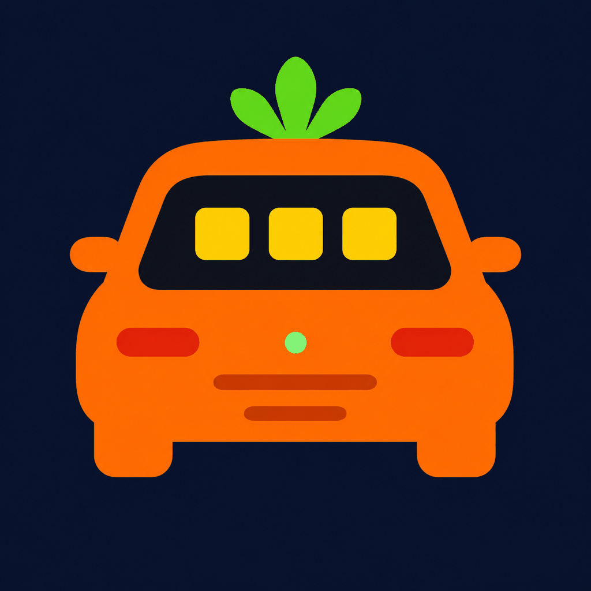
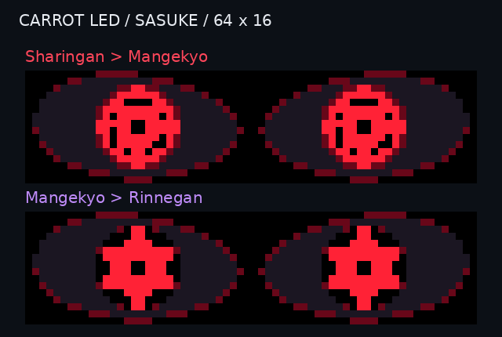
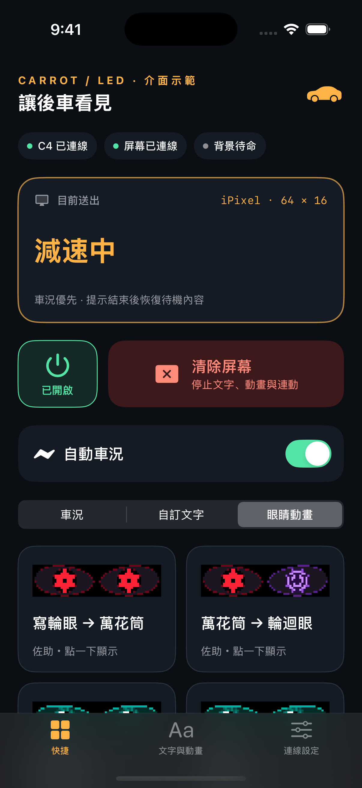
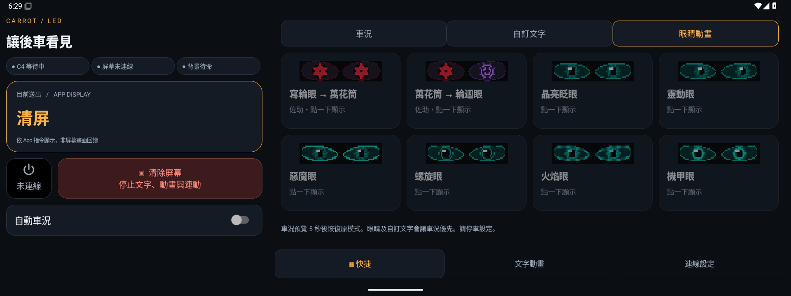
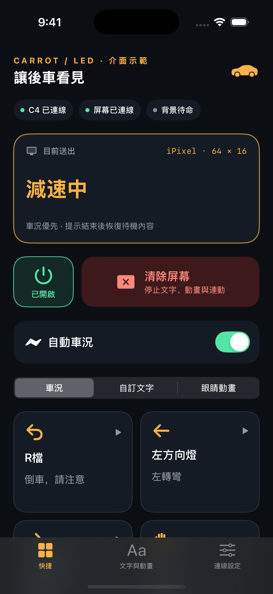
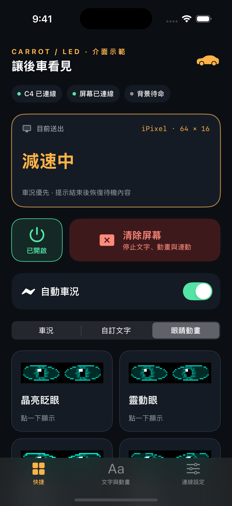
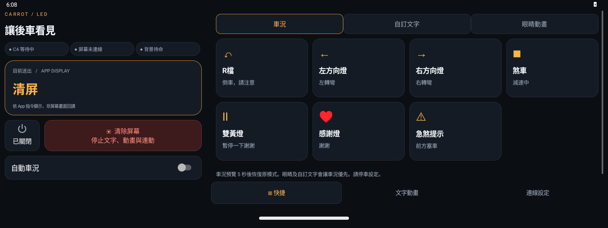
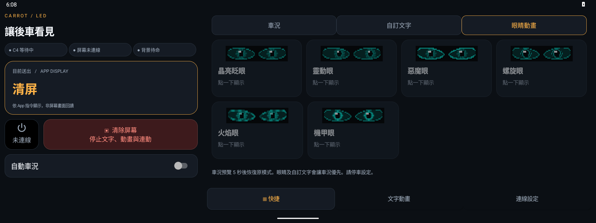
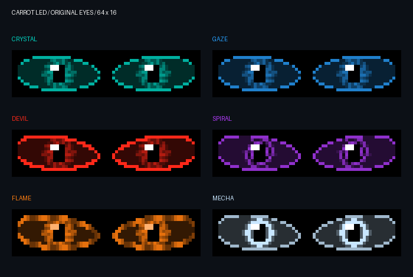

# 胡蘿蔔車 App 圖示與開屏動畫

Android 0.1.7／iPhone 0.24，採用使用者選定的橘色車身與綠葉圖示。

## 原 LOY PLAY 96×16

## iPixel 64×16

此頁 GIF 為方便觀看而循環；屏幕開屏只播放一次。預覽是 20 fps 素材放大，LOY 透過藍牙最高 5 fps 逐格傳送，實際流暢度須實測。

[更新說明](../STARTUP_UPDATE.md) · [下載與安裝](../downloads/README.md)

---

# 佐助眼睛動畫預覽

Android 0.1.6／iPhone 0.23 新增兩款，原六款保留。下方為 64×16 素材放大預覽，不是實體 LED 錄影。

[更新與安裝說明](../SASUKE_EYES_UPDATE.md)

## iPhone 畫面

使用明確標示的介面示範資料，並非實體 C4／屏幕連線回報；佐助兩款排在最前面。

## Android 15 車機畫面

尚未連線的模擬器畫面，按鈕呈灰色；佐助兩款排在最前面。

# Carrot LED 新介面預覽

Android 0.1.5 / iPhone 0.22。這些是 App 模擬器截圖，不代表實體車況或屏幕已連線。iPhone 使用明確標示的介面示範資料；Android 顯示尚未連線狀態。

## iPhone 快捷頁

## Android 車機

## 新版眼睛動畫（Android 0.1.5 / iPhone 0.22）

此處為素材播放預覽，實體屏幕的速度取決於控制板及傳輸。詳見 [播放方式與急煞門檻](../EYES_EMERGENCY_UPDATE.md)。

預覽由實際點陣產生器繪製，從上到下為眨眨眼、左右看、惡魔眼。顏色可調。這是點陣內容示意，實體藍牙傳輸流暢度尚待測試。

[下載與安裝](../downloads/README.md) · [功能說明](../UI_UPDATE.md)
