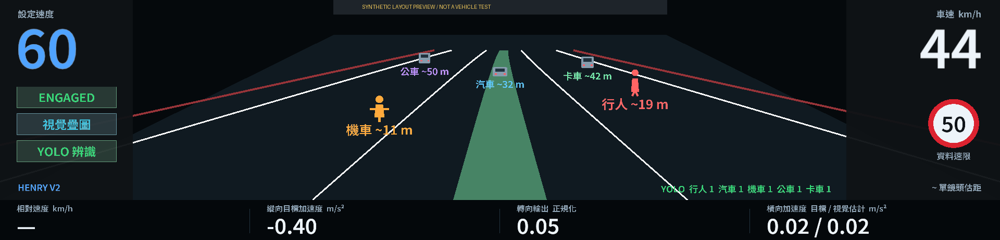

# Carrot / Mac HUD YOLO 測試版

基底：`FANHAOHSIANG/openpilot-carrot` 的 `carrot-wip`
`334a4ac52379f8e4aa0783d6637f34046d2ba892`。
分支：`test/hud-yolo-20261105`。

將 Henry HCOP 的交通物件分類、分類別 NMS、騎士去重概念移植到
Carrot 現有 HUD。辨識行人、自行車、汽車、機車、公車、卡車。
本次 V2 補上使用者參考圖的寬幅外觀：左右大字速度、中間道路與綠色路徑、
人／機車／車輛圖示、速限、狀態牌及下方四項數據。啟動器會明確選用新佈局，
畫面左下顯示 **HENRY V2**；不是只在舊版面增加辨識圖示。



以上為實際 renderer 以合成資料繪製的 1920×462 圖，不代表已在使用者硬體驗證。
道路只畫收到的模型路徑、車道與路緣；沒有資料就不畫。未定位物件只計數，
不套用範例距離。未知數值顯示「—」。此版不仿造 STOP 辨識、提前速限與道路名稱。
橫向加速度右值是視覺 yaw rate × 車速的估計，不宣稱為 IMU 實測。

## Mac 快速安裝與開啟（不用切換分支）

`install_mac_yolo.py --revision <完整 commit SHA>` 會從指定版本下載小型、帶 SHA256
清單的 YOLO 套件。在 Mac 停好車、退出 Jetlink 後，以 Python 3.12 執行安裝器。
預設使用你現有的 `~/CarrotMacHUD/carrot` 與
`~/CarrotMacHUD/jetlink/macos/build/Jetlink.app`，新環境放在 `~/CarrotHUD-YOLO`。

- 不執行 git checkout/pull，不切換 C4 或 Mac 的分支。
- 不重編譯或替換 Jetlink App，不更換 N16；YOLO 套件裝在獨立 venv。
- 在現有 Mac HUD renderer 加入繪圖掛點、兩個顯示模組及小型中文字型。
  原檔備份後才更新；不覆蓋其他 Mac／導航客製修改。介面不相容就停止。
- 可以直接升級已裝過的 V1 疊圖；保留第一次安裝前的備份，還原仍回到原版。
- 開啟時讀取既有 `hud_runtime.py` 的實際封包位置，處理 Mac 的 epoch 時間格式。
- 安裝過程若 App 重新開啟或 HUD 檔案被改動，停止套用。

安裝成功後，每次測試先退出原本 Jetlink，再執行：

```bash
bash "$HOME/CarrotHUD-YOLO/Start-YOLO.command"
```

這會啟動獨立 YOLO 程序，並開啟原本 Jetlink App；不需要再手動點一次 App。
新佈局使用 `CARROT_HUD_LAYOUT=henry-v2`，不受原先畫面模式 7 的左右分割影響。
終端機收到 `HUD 已確認載入 HENRY V2 版面` 才代表 renderer 已實際繪製新畫面。
若 30 秒內沒有回報，會顯示提示；檢查 App 的 HUD 是否開啟及 `~/CarrotHUD-YOLO/jetlink-yolo.log`。
保持終端機開啟。C4 READY、USB 連線與 HUD 影像供應正常後，會出現辨識統計。
`waiting_for_fresh_road_frame` 表示仍在等待新鮮的道路影像，不代表已辨識成功。
按 **Ctrl+C** 停止 YOLO，Jetlink App 和寬幅畫面繼續運作，辨識物件到期消失；關閉 App 也會結束該次 YOLO。
照平常方式單獨開啟 App，仍是原版 Carrot 版面，不會自動啟用 YOLO 或 Henry V2。
要切回原來的地圖／資訊版面，退出此次 App 後照原本方式重新開啟即可。

要移除顯示補丁，先退出 App 再執行：

```bash
bash "$HOME/CarrotHUD-YOLO/Restore-HUD.command"
```

若安裝後 HUD 檔案又被更新，還原工具會保留新修改並停止，不強行覆蓋。
安裝器、舊版 Mac renderer 相容處理與 epoch 封包已在桌面測試；
Mac 真正安裝、App 啟動、M4/N16 共跑與實體顯示仍待使用者機器驗證。

## 已接好的資料流

1. C4 原有 Jetlink HUD 預覽封包（`carrot_hud_v1`）提供 road JPEG。
2. Mac 的獨立 Python 程序以 ONNX Runtime CPU、2 執行緒跑 YOLO。
3. 本機小型 JSON 檔提供結果給現有 Carrot cluster renderer。
4. V2 寬幅道路顯示分類圖示與 `~距離 m`，雷達／視覺前車以藍色箭頭保留獨立來源。
   原版疊圖模式仍支援 road 相機框，不混用 wide 相機。兩種版面都將車輛警告最後繪製。

沒有新增相機訂閱、C4 模型工作、CAN 傳送或控制訊息發布。
YOLO 結果只用於顯示，沒有接到 ACC、轉向、AEB、NOO 或 N16 模型輸入。
未與雷達目標做配對；原有雷達與 YOLO 有可能同時標示同一物件。

預設關閉：HUD 程序沒有 `CARROT_HUD_YOLO_FILE` 環境變數時，沒有檔案輪詢或辨識程序。
即時辨識程序拒絕在有 `/AGNOS` 的 C4 上啟動。

## 影像與效能限制

- 本版直接使用現有 **384×240** HUD 預覽，不增加 USB 封包或 C4 影像處理負載。
  上採樣到模型尺寸不會恢復已經消失的小物件細節。
- 模型輸入固定 `672×384`，保留完整視野並做 letterbox；還原框時移除 padding。
- 最多 2 Hz，無推論佇列，使用最新影像；另限制推論占工作程序時間約 35%。
- 影像必須有有效 frame ID、來源尺寸、capture timestamp 與新鮮封包。
  同一 frame 不因封包更新而重複推論。
- 結果從估算的本機拍攝時間起 **0.8 秒到期**，過慢推論直接丟棄；斷線不保留凍結物件。
  封包時間換算使用原有 Jetlink 收件時間，無法量出隱藏的 USB 傳輸延遲。
- 平面道路距離估算只接受 C4/mici、os04c10 narrow 1344×760、有效且新鮮的
  Carrot `liveCalibration`，含 rpy 與相機高度。無校正仍可顯示 2D 分類和數量。
  不沿用 Custin 的固定高度或 0.9 距離修正係數。
- `~` 表示單鏡頭估計；斜坡、遮蔽、框底部偏差會造成誤差。不是雷達測距。
- 尚未量測使用者 Mac mini M4 與 N16 同時運行的延遲、溫度、掉幀或實體 TURZX 顯示。

## 準備公開模型（Mac，Python 3.12）

Henry 的 `c4light13` 自訓權重不在倉庫中，本次測試使用官方 YOLO11n COCO 權重。
下載後先驗證已釘選 SHA256，再匯出 ONNX；不下載未知權重，也不在即時程序中自動下載。
權重及匯出工具授權見 [NOTICE](NOTICE)。不要把套件安裝進 Jetlink 的大模型環境。

在本分支 checkout 根目錄執行：

```bash
YOLO_RUNTIME="$HOME/Library/Application Support/CarrotHUD-YOLO"
python3.12 -m venv "$YOLO_RUNTIME/venv"
"$YOLO_RUNTIME/venv/bin/python" -m pip install -r tools/jetlink/yolo/requirements.txt
"$YOLO_RUNTIME/venv/bin/python" -m pip install 'torch==2.5.1' 'torchvision==0.20.1' 'ultralytics==8.3.40' 'onnx==1.19.1' 'ml-dtypes==0.5.3'
"$YOLO_RUNTIME/venv/bin/python" tools/jetlink/yolo/prepare_model.py "$YOLO_RUNTIME/model"
YOLO_SHA=$("$YOLO_RUNTIME/venv/bin/python" -c 'import json,sys; print(json.load(open(sys.argv[1]))["onnx_sha256"])' "$YOLO_RUNTIME/model/manifest.json")
```

Linux 匯出測試使用 CPU-only torch 2.5.1+cpu；Mac 請使用原生 arm64 wheel。
不同匯出環境的 ONNX 位元組可能不同，使用當次 manifest 中的 SHA。
程式也會驗證模型輸入形狀、輸出格式、task 與 class metadata，避免類別編號錯置。

## 離線圖片或錄影測試

```bash
"$YOLO_RUNTIME/venv/bin/python" tools/jetlink/hud_yolo.py replay \
  --model "$YOLO_RUNTIME/model/yolo11n.onnx" --sha256 "$YOLO_SHA" \
  --input /absolute/path/to/road.jpg --output /tmp/yolo-photo-test
```

輸出帶框照片與 `report.json`。加 `--preview-size` 可模擬 384×240 預覽。
影片使用相同命令，`--input` 改為 MP4/HEVC/TS；`--frames 60 --fps 2` 取樣前 30 秒。
影片需要 OpenCV（上面的獨立匯出環境已包含）。離線輸出不會被即時 HUD 當成車上資料。

## 接現有 Mac HUD

上面的安裝／啟動工具會處理這一節；以下是手動啟動說明。
必須使用 Mac 正在執行的 Carrot HUD 原始碼位置與實際 snapshot 路徑。
本分支變更 `cluster_renderer.py` 並新增 `cluster_yolo_overlay.py`；Mac App 若使用
內嵌或獨立副本，必須更新該副本。**只更新 C4 不會更新 Mac App 的 HUD 程式。**
不要用整個分支覆蓋仍有未合併修改的 Mac 工作目錄。

即時工作程序：

```bash
"$YOLO_RUNTIME/venv/bin/python" tools/jetlink/hud_yolo.py live \
  --model "$YOLO_RUNTIME/model/yolo11n.onnx" --sha256 "$YOLO_SHA" \
  --snapshot "$HOME/Library/Caches/io.zoompilot.jetlink/carrot-hud/snapshot.packet" \
  --packet-clock epoch \
  --output /tmp/carrot-hud-yolo.json --seconds 60
```

Linux/原始 host 預設 snapshot 是 `/dev/shm/carrot-jetlink-hud.packet`；
Mac 預設使用上面的快取路徑；有 `CARROT_HUD_DIR` 時使用該目錄。
Swift 封包標頭為 epoch，必須先轉成本機 monotonic 時間；macOS 不使用 `/dev/shm`。
同時讓**既有 Mac HUD 啟動程序**繼承：

```bash
export CARROT_HUD_YOLO_FILE=/tmp/carrot-hud-yolo.json
```

GUI 啟動的 App 不一定繼承終端機 export，應在實際 HUD supervisor 的子程序環境設定。
停止工作程序並移除此環境變數，即恢復原本顯示。停車先確認資料與畫面，之後才能比較
YOLO 關閉/開啟時 N16 的延遲、錯誤、掉幀與系統溫度。
本次未連線到 Mac/C4、未安裝或重啟任一裝置。

## 本次測試

- 初版 144 項通過：辨識前後處理、距離座標、凍結/斷線/過期、實際 ONNX
  從合成 Jetlink 封包到 JSON，再到顯示讀取；既有 HUD、導航地圖、場景及設定回歸。
- 128 張 COCO128 公開圖片，原尺寸及 384×240 各跑一次，六種類別都有輸出。
  這是串接 smoke test，資料可能與模型訓練集重疊，**不是獨立準確率評測**。
- 機車標註共 5 個，兩種輸入皆有 5 個 IoU≥0.5 配對，同時各有 1 個額外機車預測。
  行人、遠小汽車等仍有大量漏判；不可用此小樣本推論台灣道路表現。
- AMD EPYC 測試主機、CPU 2 threads，原尺寸輸入推論中位數約 41.9 ms、p95 64.9 ms；
  預覽尺寸約 42.6 / 61.2 ms。包含前後處理，不是 Mac/N16 共用實測。
- 已以實際 Raylib/Carrot renderer 產生 1920×462 合成畫面，檢查分類圖示與警告疊放。
- 新增 Mac epoch/monotonic 兩種實際 ONNX 封包流程、安裝/還原、保留客製修改與
  準備期間檔案變動的測試；目前總數見 validation.json。
- 詳細數據見 [validation.json](validation.json)。

重跑：

```bash
YOLO_TEST_MODEL=/absolute/path/to/yolo11n.onnx \
YOLO_TEST_IMAGE=/absolute/path/to/bus.jpg \
python -m pytest --noconftest -o addopts='' \
  tools/jetlink/test_hud_yolo.py tools/jetlink/test_hud.py tools/jetlink/test_hud_nav_map.py \
  tools/jetlink/test_mac_yolo_install.py \
  openpilot/selfdrive/carrot/tests/test_cluster_scene.py \
  openpilot/selfdrive/carrot/tests/test_cluster_config.py -q
```

需要倉庫一般測試依賴與 opendbc 模組。未指定模型與圖片時，實際推論測試會明確 skip。
`render_review.py` 使用真正的 cluster renderer 產生合成畫面，只驗證版面，不是行車證據。
